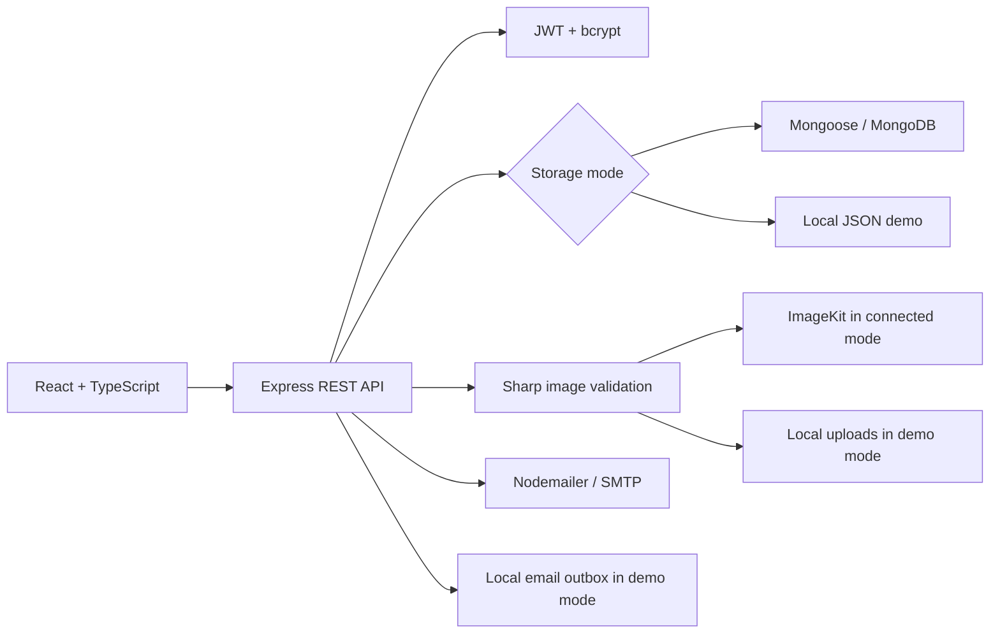

# Core requirement coverage

Based on the supplied nine-page Sapphire IQ RealEstate Platform student guide. The original PDF remains the reference; it was not modified.

| Guide module    | Implementation                                                                                                                                                                                                 |
| --------------- | -------------------------------------------------------------------------------------------------------------------------------------------------------------------------------------------------------------- |
| 1. Foundation   | Separate frontend/backend, React TypeScript, Express, User/Property/Appointment Mongoose models, JWT auth, bcrypt, Nodemailer reset flow, `/api/users/me`, ignored secrets and environment examples            |
| 2. Properties   | Owner-only create/edit/delete, up to four images using Multer + ImageKit, image gallery, literal search, price/type/location/area filters, React Router, Tailwind, lazy pages                                  |
| 3. Appointments | Separate guest/auth booking routes sharing one model, pending/confirmed/cancelled status, owner confirmation, attendee cancellation, guest management links, protected dashboard and AuthContext, Axios client |
| 4. Production   | Helmet, CORS allowlist, origin checks, rate limits, SEO tags, robots and sitemap, deep links, Render and Vercel configuration, environment validation and deployment instructions                              |
| 5. Optional AI  | Not implemented; the four core modules run independently of AI services                                                                                                                                        |

The platform is built and locally verified. Account provisioning, real external-service validation, and actual deployment are remaining configuration work; deployment files do not mean the site is live.

## Architecture

API responses explicitly select public fields; password/reset hashes stay server-side. Property and viewing permissions are checked at the API, independently of UI visibility. Active appointments use a unique property/time slot key; cancellation removes the key to free the slot. ISO timestamps are normalized before generating this key. Password resets consume a hashed token atomically and increment a session version.

MongoDB queries perform property filtering, sorting, counting and pagination. Demo storage implements the corresponding limited query semantics and serializes writes to a persistent JSON file. It is for a single local process, never production. Mongoose initializes the unique email and active-slot indexes before the server starts.

Images are accepted only as JPEG, PNG or WebP, decoded and re-encoded, resized to fit 1920×1440, and stripped of original metadata. The API stores only server-generated image identifiers and URLs. Optimistic checks reject conflicting image modifications and attempt cleanup if an upload fails partway through.

The frontend uses reusable cards, forms, notices, loading and empty states. Main pages are lazy-loaded. Form labels, semantic navigation, keyboard focus styles and a mobile menu support accessible interaction. All viewing timestamps are labelled IST.
