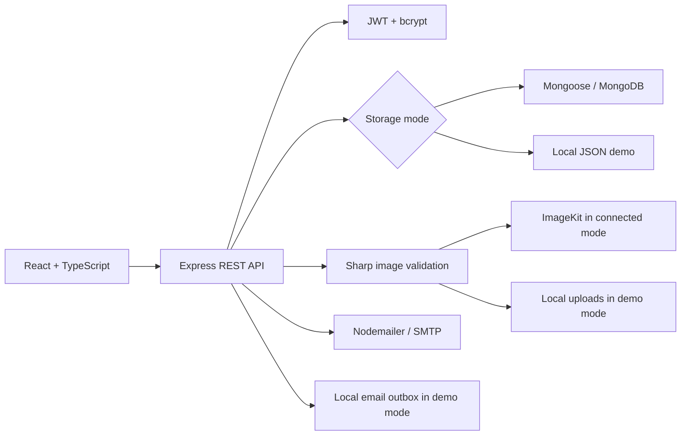

# How I covered the core requirements

I followed the supplied nine-page Sapphire IQ RealEstate Platform guide. I kept the original PDF as reference material and did not modify it.

| Guide module    | What I implemented                                                                                                                                                                                                                                 |
| --------------- | -------------------------------------------------------------------------------------------------------------------------------------------------------------------------------------------------------------------------------------------------- |
| 1. Foundation   | I created separate frontend/backend apps, React TypeScript pages, Express routes, User/Property/Appointment Mongoose models, JWT authentication, bcrypt hashing, Nodemailer reset flow, `/api/users/me`, environment examples and ignored secrets. |
| 2. Properties   | I implemented owner-only CRUD, up to four images through Multer and ImageKit, a gallery, literal search, price/type/location/area filters, React Router, Tailwind and lazy pages.                                                                  |
| 3. Appointments | I implemented guest/authenticated booking routes with one model, pending/confirmed/cancelled statuses, owner confirmation, attendee cancellation, private guest links, AuthContext, Axios and a protected dashboard.                               |
| 4. Production   | I added Helmet, CORS rules, origin checks, rate limits, SEO tags, robots, a database sitemap, deep links, environment validation, deployment instructions and Vercel/Render configuration.                                                         |
| 5. Optional AI  | I have not implemented the optional AI module. I kept the core platform independent of AI services.                                                                                                                                                |

I deployed the full platform on Vercel with Atlas, ImageKit and Gmail SMTP configured. I passed live account, cookie-session and ImageKit upload checks. I have not tested live email delivery or viewing submission because I chose to skip sending email during setup.

## How I structured the application

I select public fields explicitly in API responses and keep password/reset hashes on the server. I enforce property and viewing permissions in the API, independently of what the UI displays. I reserve active appointments with a unique property/time slot key, normalize ISO timestamps before generating it, and remove the key on cancellation. I consume reset tokens atomically and increment the account's session version.

I run property filtering, sorting, counting and pagination in MongoDB. For local demonstrations, I implement the corresponding query behavior over a persistent JSON file with serialized writes. I limit that adapter to one local process and forbid it in production. I initialize unique email and active-slot indexes before starting the server.

I accept JPEG, PNG and WebP images, up to four photos and 4 MB per file. I decode, resize to fit 1920×1440, re-encode and strip the original metadata through Sharp. I store server-generated image identifiers and URLs, reject conflicting image updates and attempt cleanup after partial upload failures. I send one image per browser request to fit Vercel's payload limit.

I built reusable cards, forms, notices, loading states and empty states. I lazy-load the main pages, label all viewing times in IST, and include form labels, semantic navigation, focus styles and a mobile menu.
