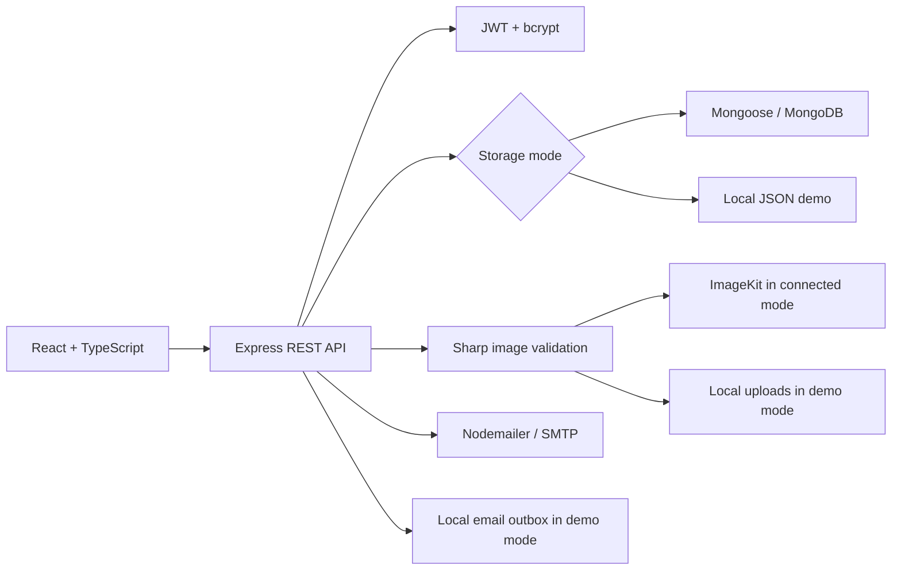

# Requirements and architecture

This project follows the four core modules in the Sapphire IQ RealEstate Platform guide. The optional AI module has been left out.

## Requirement coverage

| Module       | Implementation                                                                                                                                                                   |
| ------------ | -------------------------------------------------------------------------------------------------------------------------------------------------------------------------------- |
| Foundation   | Separate React/TypeScript frontend and Express backend; User, Property and Appointment models; JWT authentication; bcrypt; password reset; `/api/users/me`; environment examples |
| Properties   | Owner-only create/edit/delete; up to four photos; Multer and ImageKit uploads; gallery; keyword, city, type, price and area filters; sorting and pagination                      |
| Appointments | Guest and registered-user requests; pending/confirmed/cancelled status; owner confirmation; attendee cancellation; guest management links; protected dashboard                   |
| Production   | Helmet, CORS, origin checks, rate limits, SEO tags, robots, sitemap, deep links, environment validation and deployment configuration                                             |
| Optional AI  | Not implemented                                                                                                                                                                  |

The full app runs on Vercel with Atlas, ImageKit and Gmail SMTP configured. Live account and image-upload checks passed. Email delivery and live viewing submission remain untested.

## Application structure

## Main implementation decisions

I kept permission checks in the API rather than relying on the frontend. Responses select public fields explicitly, so password and reset-token hashes stay on the server.

Active viewings use a unique property/time slot key. Timestamps are normalized before that key is created, and cancelling a request frees the slot. Password resets consume a hashed token atomically and increment the account's session version.

MongoDB handles property filtering, sorting, counting and pagination. Local demo storage provides the same required query behavior over a JSON file, with serialized writes. It is intended for one local process and cannot be enabled in production. Mongoose initializes the unique email and viewing-slot indexes at startup.

Photos must be JPEG, PNG or WebP, with a maximum of four per property and 4 MB per file. Sharp decodes them, strips the original metadata, resizes them to fit 1920×1440 and converts them to WebP. Conflicting photo updates are rejected, and partial uploads are cleaned up where possible.

The frontend shares cards, forms, notices and loading/empty states across pages. Main routes are lazy-loaded. Form labels, keyboard focus styles and the mobile menu support navigation on different screen sizes. Viewing times are displayed in IST.
